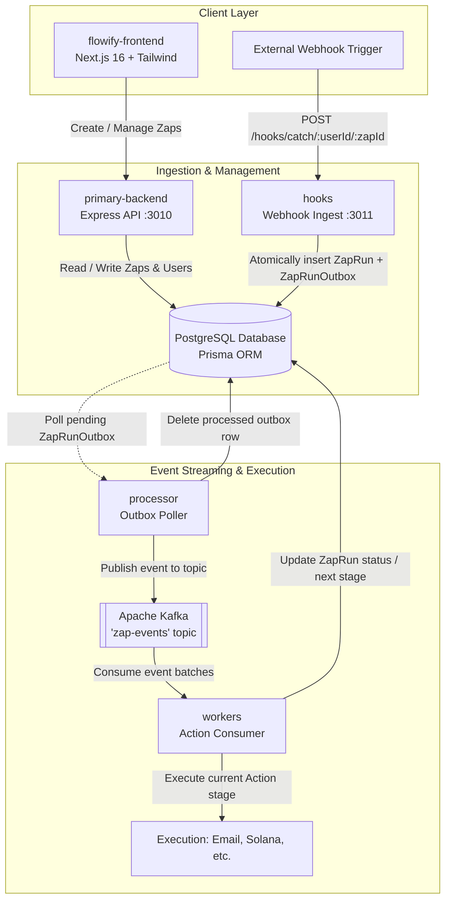

# Flowify ⚡ - Distributed Workflow Automation Engine

Flowify is an event-driven workflow automation platform (similar to Zapier) built on a microservices architecture. It allows users to define triggers (webhooks, schedules), configure multi-step actions (Email notifications, Solana token transfers), and reliably execute them using the **Transactional Outbox Pattern** and **Apache Kafka**.

---

## 🏗️ Architecture Overview

Flowify separates user-facing APIs, webhook ingestion, and event processing into distinct, decoupled services:



### The Transactional Outbox Pattern
1. When a webhook arrives at **`hooks`**, it opens a single atomic database transaction:
   - Creates a **`ZapRun`** record tracking the execution state.
   - Inserts a **`ZapRunOutbox`** record pointing to the run.
2. The **`processor`** service periodically polls for pending rows in `ZapRunOutbox`.
3. For each outbox record, it publishes the event payload to Kafka and deletes the outbox entry in the same transaction loop.
4. The **`workers`** service consumes events from Kafka, loads the Zap action pipeline, executes external side-effects (Email, Crypto), and updates the run status.

---

## 📁 Repository Structure

```text
├── flowify-frontend/     # Next.js 16 App Router UI (Tailwind CSS, Lucide icons)
├── primary-backend/      # Express API: Auth, Zap management, triggers, actions
├── hooks/                # High-throughput webhook ingestion endpoint
├── processor/            # Background service: outbox-to-Kafka publisher
├── workers/              # Background service: Kafka consumer & action runner
├── packages/
│   └── shared/           # Shared Prisma database client & Kafka configuration
├── prisma/
│   ├── schema.prisma     # Unified database schema
│   └── migrations/       # Database migration history
├── package.json          # Root workspace configuration
└── .env.example          # Template for all environment variables
```

---

## 🚀 Quickstart (Local Development)

### 1. Prerequisites
- **Node.js** (v18 or v20+) and **npm**
- **PostgreSQL** instance running locally or in Docker
- **Apache Kafka** instance (or Dockerized Kafka / Redpanda)

### 2. Clone & Install Dependencies
```bash
git clone <repository-url>
cd flowify
npm install
```

### 3. Setup Database Schema
Configure your `.env` at root or pass your PostgreSQL URL:
```bash
# Push schema to database
npx prisma db push

# Generate Prisma Client
npx prisma generate
```

### 4. Build Monorepo Packages
```bash
# Compile TypeScript across all workspaces
./primary-backend/node_modules/.bin/tsc -b
```

### 5. Start Services
Run each service in a separate terminal tab:

```bash
# Terminal 1: Primary Backend API (:3010)
npm run dev:backend

# Terminal 2: Webhook Ingestion Service (:3011)
npm run dev:hooks

# Terminal 3: Outbox Processor
npm run dev:processor

# Terminal 4: Kafka Action Worker
npm run dev:workers

# Terminal 5: Frontend UI (:3000)
npm run dev:frontend
```

---

## ⚙️ Environment Variables Reference

| Variable | Target Services | Default (Local) | Description |
| :--- | :--- | :--- | :--- |
| `DATABASE_URL` | All backend services | `postgresql://...:5432/flowify` | PostgreSQL connection string |
| `JWT_PASSWORD` | `primary-backend` | - | Secret string for signing auth tokens |
| `PORT` | `primary-backend` | `3010` | HTTP port for primary REST API |
| `HOOKS_PORT` | `hooks` | `3011` | HTTP port for webhook ingestion |
| `KAFKA_BROKER` | `processor`, `workers` | `localhost:9092` | Comma-separated Kafka broker addresses |
| `KAFKA_CLIENT_ID` | `processor`, `workers` | `outbox-processor` | Client identifier for Kafka connection |
| `KAFKA_TOPIC` | `processor`, `workers` | `zap-events` | Kafka topic name for workflow events |
| `KAFKA_CONSUMER_GROUP` | `workers` | `flowify-worker-dev-v2` | Kafka consumer group ID |
| `KAFKA_SSL` | `processor`, `workers` | `false` | Set to `"true"` for cloud-managed Kafka |
| `KAFKA_USERNAME` | `processor`, `workers` | - | SASL username (Upstash / Confluent / Aiven) |
| `KAFKA_PASSWORD` | `processor`, `workers` | - | SASL password |
| `KAFKA_SASL_MECHANISM` | `processor`, `workers` | `plain` | SASL mechanism (`scram-sha-256` or `plain`) |
| `EMAIL_USER` | `workers` | - | Gmail / SMTP email address for sending alerts |
| `EMAIL_PASS` | `workers` | - | SMTP App Password |
| `NEXT_PUBLIC_BACKEND_URL` | `flowify-frontend` | `http://localhost:3010/api/v1` | Public API endpoint for frontend requests |
| `NEXT_PUBLIC_HOOKS_URL` | `flowify-frontend` | `http://localhost:3011/hooks/catch` | Public webhook URL for zap trigger URLs |

---

## 🐳 Run Locally with Docker Compose

You can launch the entire stack (PostgreSQL, KRaft Kafka, Backend, Webhooks, Outbox Processor, Workers, and Frontend) with a single command:

```bash
docker compose up --build
```

- **Frontend**: http://localhost:3000
- **Primary Backend API**: http://localhost:3010
- **Webhook Ingestion**: http://localhost:3011
- **PostgreSQL**: `localhost:5432`
- **Kafka**: `localhost:9092`

To shut down:
```bash
docker compose down
```

---

## 🚢 Production Deployment Guide

### Railway Deployment (All Backend Services in One Place)

Railway is the best platform for this project because it hosts your database, APIs, and background workers in the same private network:

1. **Create a Railway Project**:
   - Go to [railway.app](https://railway.app) and create a **New Project**.
2. **Add PostgreSQL (Built-in Plugin)**:
   - Click **+ New** -> **Database** -> **Add PostgreSQL**.
   - Railway automatically sets up PostgreSQL and creates a private `DATABASE_URL`.
3. **Kafka Setup**:
   - **Option A (Recommended & Free)**: Create a free cluster on [Upstash Kafka](https://upstash.com), create topic `zap-events`, and copy the broker URL & credentials.
   - **Option B**: In Railway, click **+ New** -> **Docker Image** -> enter `apache/kafka:latest`.
4. **Deploy Backend Services from your GitHub Repo**:
   For each service, click **+ New** -> **GitHub Repo** -> select this repository:
   - **`primary-backend`**:
     - Settings -> **Dockerfile Path**: `docker/Dockerfile.backend`
     - Variables: `DATABASE_URL=${{Postgres.DATABASE_URL}}`, `JWT_PASSWORD=your-secret`
     - Settings -> Generate Public Domain (e.g. `api.yourproject.up.railway.app`)
   - **`hooks`**:
     - Settings -> **Dockerfile Path**: `docker/Dockerfile.hooks`
     - Variables: `DATABASE_URL=${{Postgres.DATABASE_URL}}`
     - Settings -> Generate Public Domain (e.g. `hooks.yourproject.up.railway.app`)
   - **`processor`**:
     - Settings -> **Dockerfile Path**: `docker/Dockerfile.processor`
     - Variables: `DATABASE_URL=${{Postgres.DATABASE_URL}}`, Kafka credentials
   - **`workers`**:
     - Settings -> **Dockerfile Path**: `docker/Dockerfile.workers`
     - Variables: `DATABASE_URL=${{Postgres.DATABASE_URL}}`, Kafka credentials, `EMAIL_USER`, `EMAIL_PASS`
5. **Deploy Frontend (Vercel)**:
   - Connect repository on [Vercel](https://vercel.com) with Root Directory `flowify-frontend`.
   - Set `NEXT_PUBLIC_BACKEND_URL` to your Railway backend domain + `/api/v1`.
   - Set `NEXT_PUBLIC_HOOKS_URL` to your Railway hooks domain + `/hooks/catch`.

---

## 🔄 Local vs Production: What Changes?

| Component | Local Development | Production Deployment |
| :--- | :--- | :--- |
| **Frontend URL** | `http://localhost:3000` | `https://app.yourdomain.com` (Vercel / Custom domain) |
| **Backend API URL** | `http://localhost:3010` | `https://api.yourdomain.com` (Cloud Web Service) |
| **Hooks / Webhook URL** | `http://localhost:3011/hooks/catch` | `https://hooks.yourdomain.com/hooks/catch` (Must be public HTTPS for third parties) |
| **PostgreSQL Database** | `localhost:5432` | Hosted connection string (e.g., Supabase / Neon with SSL pooling enabled) |
| **Kafka Broker** | `localhost:9092` (Plaintext, No Auth) | Cloud broker address (e.g. `upstash-kafka.upstash.io:9092`) with `KAFKA_SSL=true` and SASL credentials |
| **Port Assignment** | Hardcoded (`3010`, `3011`) | Assigned dynamically by cloud hosts via `process.env.PORT` |
| **Start Commands** | `npm run dev` (ts-node / nodemon) | `npm start` (`node dist/index.js` or `npm run start` for Next.js) |

---

## 🛠️ Verification & Building for Production

Compile all TypeScript packages prior to deployment:
```bash
# 1. Compile backend & shared packages
./primary-backend/node_modules/.bin/tsc -b

# 2. Build Next.js frontend
cd flowify-frontend && npm run build
```

Run production start commands:
```bash
npm run start:backend    # Starts primary-backend
npm run start:hooks      # Starts hooks
npm run start:processor  # Starts outbox processor
npm run start:workers    # Starts action worker
npm run start:frontend   # Starts Next.js production server
```

